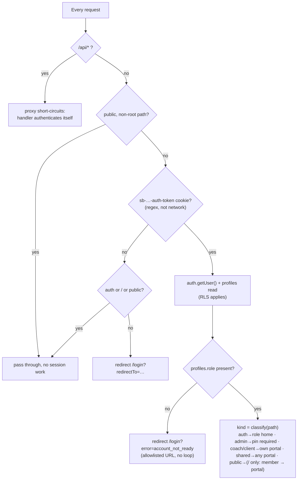
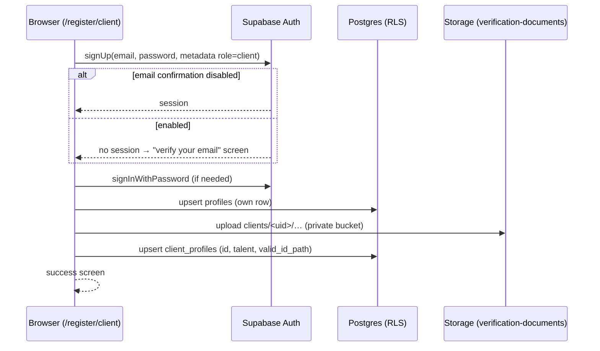

# GroovePH — Authentication & Authorization Flows

> Verified 2026-11-19 by reading every file listed. "Verified" means the code does what is described; it does **not** mean the flow was executed end-to-end (no runtime testing was performed). Where behavior is uncertain or a limitation exists, it is called out under **Known gaps**.

**Key actors and files (referenced below by short name)**

| Short name | Path | Role |
|---|---|---|
| proxy | `proxy.ts` → `lib/supabase/middleware.ts` (`updateSession`) | Edge request classifier + session refresh + role redirects |
| client | `lib/supabase/client.ts` | Memoized **browser** Supabase client |
| server | `lib/supabase/server.ts` | Cookie-bound **server** client (`createClient`) + privileged `createAdminClient` |
| access | `lib/admin/access.ts` | `isAdminIdentity({role, email})` — the only definition of "admin" |
| guard | `lib/admin/guard.ts` | `getAdminIdentity()` / `requireAdmin()` (throws `.status = 403`) |
| page(public) | `app/(public)/page.tsx` | Front-door SSR role redirect (mirrors proxy) |
| admin layout | `app/admin/layout.tsx` | Server gate for the whole `/admin` tree |
| callback | `app/auth/callback/route.ts` | OAuth/PKCE code exchange |
| callback types | `lib/googleRegistration.ts` | Google OAuth start + completion logic |
| mw constants | `SUPABASE_AUTH_COOKIE = /^sb-.+-auth-token(\.\d+)?$/` | Optimistic "has session?" check |

**The one rule of authorization:** everything about *who* a user is comes from the `profiles` table (server-side read). `user_metadata.role` is supplied by the client at signup and is **never** trusted for authorization.



---

## 1. Client registration (email/password)

**Starting point:** `/register/client` — `app/(public)/(auth)/register/client/page.tsx` (821 lines, Client Component).

**Flow**

1. User picks "Client / Performer" from the register modal on `/login` (or navigates directly).
2. 3-step wizard: Step 1 personal + contact/account + address (`RegistrationFormFields`, `AddressSelector` — PH PSGC data, SJDM primary), Step 2 client details + ID document upload, Step 3 terms review. Validation is inline (no zod on this form).
3. Submit → `supabase.auth.signUp()` with `emailRedirectTo: ${origin}/auth/callback` and `options.data = { role: 'client', custom_id, firstname, middlename, lastname, username, contact, talent }`.
   - If email confirmation is **disabled** in the project, `signUp()` returns a session → upload proceeds immediately.
   - If **enabled**, `session === null` and `email_confirmed_at === null` → the page shows a "verification required" success state and stops (no profile writes, no uploads).
4. Welcome email: best-effort `POST /api/send-email` (non-blocking; failures logged, never abort registration).
5. If no session: `signInWithPassword()` to obtain one for storage writes.
6. **Profile upsert** (`profiles`, full column set incl. `address_summary`, `terms_accepted: true`, `email_verified: false`).
7. **ID upload** to private bucket `verification-documents` under `clients/<uid>/<ts>_<custom_id>.<ext>` (upsert:false). A failed upload aborts before `valid_id_path` is written — the error tells the user the account exists but is unverified.
8. **`client_profiles` upsert** (`id`, `talent`, `valid_id_path`).
9. Success screen → `registeredSuccess` state with "check your email" copy if confirmation is pending.

**Failure handling:** rate-limit (`429`/`over_email_send_rate_limit`) → wait message (no retry); duplicate email (`422`/`already`) → "sign in instead"; obfuscated identity (empty `identities[]`) → same message; trigger failure (`database error saving new user`) → surfaces Supabase message.

**Tables:** `auth.users` (via Auth), `profiles`, `client_profiles`; bucket `verification-documents`.
**Session/cookies:** established by `signUp()` (if confirmation off) or by the immediate `signInWithPassword`.
**Redirect:** success → in-page success screen (no navigation); errors → inline.
**Verification:** `profiles.account_verified` + ID document review is performed later in `/admin/verifications` (admin-only). Until verified, booking/coach features may be gated (`features/verification`).



---

## 2. Coach registration (email/password)

**Starting point:** `/register/coach` — `app/(public)/(auth)/register/coach/page.tsx` (1,506 lines, Client Component; heaviest page in the repo).

**Same skeleton as client registration**, with these differences:

- 4 steps (personal → contact/account → skills/rates → documents).
- `options.data` includes coach-specific metadata: `talents`, `skill`, `skills[]`, `genres` (a JSON-stringified structured object), `custom_id`.
- Uploads **ID document + selfie + credentials** to `verification-documents` under `coaches/<uid>/…`.
- Upserts `profiles` **and** `coach_profiles` (`talents`, `skills`, fee summary, genres JSON…).
- Ends in the same "verification required / success" states.

**Tables:** `coach_profiles`, `profiles`, bucket `verification-documents`.
**Google path:** see §5.

---

## 3. Login (email/password)

**Starting point:** `/login?redirectTo=…&error=…` — `app/(public)/(auth)/login/page.tsx` (374 lines, Client Component).

**Flow (verified)**

1. Suspense-boundary page; username **or** email in one field.
2. If input has no `@` → resolve `username → email` via `profiles.select('email, role, status').eq('username', …)`.
3. `supabase.auth.signInWithPassword({ email, password })`.
4. On error: `email not confirmed` / `database error loading user` / generic → specific messages.
5. Read `profiles` (`select('*')`) — if no `role` → show "account has no profile yet" (do not redirect).
6. `profiles.status → 'online'` (best-effort presence).
7. **Role routing (subject to the pinned-admin rule):**
   - `isAdminIdentity({ role, email })` → `/admin/dashboard`.
   - `role === 'admin'` (not pinned) → treated as **client** (`/client/home`) — never the console.
   - `redirectTo` honored if it starts with `/`, not `//`, not `/admin*`, and not the wrong portal (`/client*` for coaches, `/coach*` for clients).
   - Otherwise `/coach/home` | `/client/home`.
8. `groove_welcome_pending` set in `sessionStorage` (doubles as one-time welcome-modal trigger) → `router.refresh()`.

**Why the login page re-routes itself instead of trusting the proxy:** the proxy also redirects `/` and auth routes by the same rule; both exist by design (defense in depth). Redirect loops were a historical bug class here — see `lib/supabase/middleware.ts` comments on `account_not_ready`.

**Error handling:** inline `FormError`; unknown `?error=…` values map to specific copy; unknown values render nothing.

```mermaid
flowchart TD
    L[/login] --> INPUT{has @ ?}
    INPUT -- no --> RS[resolve username → email via profiles]
    INPUT -- yes --> SIP
    RS --> SIP[signInWithPassword]
    SIP --> ERR{auth error?}
    ERR -- yes --> MSG[specific message\n(not confirmed / stale session / generic)]
    ERR -- no --> PROF["select * from profiles"]
    PROF --> ROLE{role present?}
    ROLE -- no --> NP["message: no dashboard available"]
    ROLE -- yes --> PIN{isAdminIdentity?}
    PIN -- yes --> ADM[/admin/dashboard]
    PIN -- no --> ADMIN{role == admin?}
    ADMIN -- yes --> CL[/client/home]
    ADMIN -- no --> RT{safe same-origin\nredirectTo?\nnot /admin, right portal}
    RT -- yes --> DEST[redirectTo]
    RT -- no --> HOME["/coach/home | /client/home"]
```

---

## 4. Logout

**Trigger points:** `components/header/AppHeader.tsx#handleLogout` (public chrome), `components/layout/DashboardChrome.tsx` (dashboards), `SettingsSections.tsx` (danger zone), `app/(client|coach)/settings/page.tsx`. Profile menus/drawers (`ProfileMenuContent`, `MobileDrawer`) delegate to their parents' handlers.

All handlers call the canonical utility **`lib/auth/signOut.ts#signOutEverywhere(userId?)`** (Phase 3):

1. Best-effort `profiles.status='offline'` update (never blocks sign-out).
2. Clears the `groove_welcome_pending` sessionStorage flag.
3. `supabase.auth.signOut()`.

Callers then navigate with `router.push('/login'); router.refresh()`. Authorization is untouched — the utility only ends the caller's own session.

No server action, no API call — cookie is cleared client-side; the proxy treats the next request as anonymous (no cookie ⇒ `/login` on protected routes).

---

## 5. Session restoration & Google OAuth

**Restoration:** on every browser load, `SessionProvider` (`components/providers/SessionProvider.tsx`, mounted at root) calls `getUser()` + `onAuthStateChange` once and distributes via context (`useSession()`). The **proxy** independently ensures cookies are fresh on each request (Supabase SSR cookie rotation).

**Google registration (email/password alternative) — verified chain:**

1. `/register/client` or `/register/coach` → `GoogleRegisterButton` (`components/shared/GoogleRegisterButton.tsx#startGoogleRegistration(role)`).
2. `signInWithOAuth({ provider: 'google', redirectTo: ${origin}/auth/callback?next=/register/complete?role=<role>&role=<role> })`.
   - `supabase.auth.signInWithOAuth` **cannot set user metadata**, so the role rides in the URL (allowlisted at the callback).
3. Supabase → Google consent → `/auth/callback?code=…&role=<role>&next=/register/complete?role=<role>`.
4. `callback/route.ts`: `exchangeCodeForSession(code)`; `role` validated against allowlist (`client|coach`); `next` validated as in-app path; redirects to `/register/complete?role=…` (for `type=recovery`, always `/reset-password`).
5. `/register/complete` (`app/(public)/(auth)/register/complete/page.tsx`) → `completeGoogleRegistration(role)` (`lib/googleRegistration.ts`):
   - Reads the profile row the `handle_new_user` trigger already created (must exist — self-INSERT is forbidden).
   - Detects existing sub-profile (`client_profiles`/`coach_profiles`): exists → status `existing` (never re-onboarded).
   - Detects opposite-role established account → `wrong-role` screen (no silent role swap).
   - Otherwise patches `profiles` (`email_verified: true`, names if missing, `custom_id`) and inserts the sub-profile (`talent`/`talents` = 'Dance', `valid_id_path` null → account unverified until ID upload).
   - Welcome email best-effort.
6. Redirect to `/client/home` or `/coach/home` via `router.replace(GOOGLE_ROLE_DASHBOARD[role])`.

**Google sign-in from /login is NOT wired:** `AuthUI.GoogleButton` renders with `onClick={() => console.log('Google sign-in clicked')}`. The working implementation (`components/shared/GoogleSignInButton.tsx#startGoogleSignIn` + `completeGoogleSignIn` in `lib/googleRegistration.ts`) exists but has **zero importers**. `/register/complete` also handles `next`-based completion for a hypothetical Google login flow. Until the button is wired to `startGoogleSignIn(next)`, "Continue with Google" on `/login` is a no-op UI element.

**Known gaps / honesty notes**
- `/login` Google button: inert (see above) — HIGH-priority fix, no code change performed by this audit.
- Google OAuth creates unverified accounts that cannot self-upload documents until email verification completes.
- `completeGoogleRegistration` reads `profiles.role` as the trusted role; the URL `role` can only choose the sub-profile table, and only after the trigger ran — this is by design (documented in the file).

---

## 6. Protected routes (who enforces what)

| Route group | Enforcement |
|---|---|
| `/client/*` | proxy: needs session + profile role `client` (or full admin). Page-level: client pages re-check `profiles.role` and redirect. |
| `/coach/*` | proxy: role `coach` (or full admin). Page-level re-check. |
| `/admin/*` | proxy: full admin identity only → else bounce to own portal. `app/admin/layout.tsx`: **server** gate, authoritative — `getAdminIdentity()` (session + profiles read via caller's own RLS session + pin). Failure redirects, never renders an error. |
| `/messages`, `/contracts/*`, `/userprofile/*` | classified `shared` by proxy: session required; member of either portal (or full admin). |
| `/api/*` | excluded from proxy; **each handler authenticates itself** (`getUser` → 401, `requireAdmin` → 403, `CRON_SECRET`, `INGEST_API_KEY`, or public-by-design). |
| `/` (front door) | proxy: guests see landing; members are redirected to role home. `app/(public)/page.tsx` enforces the same rule during SSR (belt and suspenders). |

**Failure behavior:** missing/stale session ⇒ `/login?redirectTo=<path>` (loop-free); missing profile row ⇒ `/login?error=account_not_ready` (special-cased to avoid `ERR_TOO_MANY_REDIRECTS`); `profiles` read error ⇒ `/login` with no error param (never presented as "not ready").

```mermaid
flowchart TD
    REQ[Request /admin/bookings] --> P{proxy cookie check}
    P -- no cookie --> L["/login?redirectTo=/admin/bookings"]
    P -- cookie --> U[auth.getUser + profiles read]
    U --> ROLE{role='admin' and email pinned?}
    ROLE -- no --> FB{role known?}
    FB -- coach --> CH[/coach/home]
    FB -- client/admin-non-pinned --> CL[/client/home]
    ROLE -- yes --> GE{"admin layout: getAdminIdentity()"}
    GE -- fail --> FB2{who are we?}
    FB2 --> HOME[roleHome or /login]
    GE -- ok --> PAGE[render /admin/bookings]
```

---

## 7. Admin access (the four gates)

1. **proxy** — `kind === 'admin'` requires `isAdminIdentity({ role, email })`. Not pinned ⇒ bounce to `/client/home` (or `/coach/home` for coaches). Role-'admin'-but-not-pinned can never enter the console.
2. **`app/admin/layout.tsx`** — authoritative server gate; re-derives identity with **RLS** (the read itself is bound by caller session). Redirect, never render.
3. **`requireAdmin()`** (`lib/admin/guard.ts`) — for route handlers that touch service-role-only data: `/api/admin/users`, `/api/admin/audit`. Throws `.status=403`. All methods of `/api/admin/users` call it.
4. **Postgres** — `public.is_admin()` (STABLE SECURITY DEFINER; email pin is hard-coded because SQL cannot read `process.env`) guards admin RLS policies. **Changing the admin address requires a migration**, not just an env var.

**Optional second factor:** `/admin/verify-passcode` — 6-digit passcode from `ADMIN_PASSCODE`; constant-time SHA-256 digest comparison; re-verifies session + pin before redirecting to `/admin/dashboard`. Nothing links to it; it is directly navigable by a pinned admin.

**Admin role assignment:** `/api/admin/users` POST creates accounts with `email_confirm: true`, `role` chosen by admin; PATCH can change roles but guards the pinned account and the last admin; role flip for self is blocked. `guard_role_assignment` SQL trigger provides defense-in-depth at the database.

---

## 8. Role-based access control — matrix

| Resource | Guest | Client | Coach | Admin (pinned) |
|---|---|---|---|---|
| Public pages, `/community/*`, `/users`, `/userprofile/[id]` | ✅ | ✅ | ✅ | ✅ |
| `/client/*` | ❌ → /login | ✅ | ❌ → /coach/home | ✅ |
| `/coach/*` | ❌ → /login | ❌ → /client/home | ✅ | ✅ |
| `/admin/*` | ❌ | ❌ | ❌ | ✅ |
| `/messages`, `/contracts/*` | ❌ | ✅ (own) | ✅ (own) | ✅ |
| `/api/groovey/*` | 401 | ✅ rate-limited | ✅ | ✅ |
| `/api/admin/*` | 403 | 403 | 403 | ✅ |
| RLS rows | public reads only | own rows | own rows + own clients | all (via policies using is_admin()) |

**Cross-check:** `lib/permissions.ts` predicates exist for UI branching only; they are **not** a security boundary (no email pin).

---

## 9. Password reset / forgot-password

**Forgot:** `/forgot-password` (`app/(public)/(auth)/forgot-password/page.tsx`) — `resetPasswordForEmail(email, { redirectTo: ${origin}/auth/callback?type=recovery })`. Success state; anti-enumeration (same message either way).

**Callback:** `type=recovery` ⇒ always `/reset-password` (ignores `next`).

**Reset:** `/reset-password` — on mount, checks for an existing session (recovery links carry one). Requires ≥8 chars + confirmation; `supabase.auth.updateUser({ password })`; success screen → `/login`.

**Verified gaps:** none in the code path; delivery depends on Supabase Auth SMTP (documented to use Resend).

---

## 10. Profile creation & synchronization

**Creation paths (three):**
1. Email/password signup — `handle_new_user()` trigger (SQL) creates the `profiles` row from user metadata at `auth.users` insert. Client then upserts the remaining columns.
2. Google OAuth — same trigger; row may arrive with `role` from metadata (client/coach for registration, default 'client' for pure sign-in).
3. Admin-created accounts (`/api/admin/users`) — Auth admin API with `email_confirm: true`; the trigger still runs; `/api/admin/users` also upserts sub-profiles.

**Half-created accounts ("account_not_ready"):** if the trigger fails or the row is deleted, the session exists but `profiles.role` is null. The proxy **refuses** to default it to `client` (historical data-leak bug class) and redirects to `/login?error=account_not_ready`. The login page renders an explanatory message instead of looping. Recovery: contact support / re-register.

**Synchronization rules (verified):**
- `profiles` is the single source of truth for role, status, verification, masking-visible PII.
- Presence: `profiles.status` written by header logout, login, and `PresenceBridge` (Realtime on UPDATE).
- Achievements: `user_achievements` via server actions (`app/actions/achievements.ts`).
- Follows: `profile_follows` (migration 09) via `lib/profileFollows.ts`.
- Username ↔ email: login resolves usernames to emails via `profiles.username`.

---

## 11. Verified implementation checklist vs. missing pieces

| Flow | Status |
|---|---|
| Client registration (email/password) | ✅ Implemented, ID upload enforced |
| Coach registration (email/password) | ✅ Implemented, ID+selfie+credentials |
| Google registration | ✅ Implemented, role via URL allowlist at callback |
| Login (username or email) | ✅ Implemented, `redirectTo` honored safely |
| Logout | ✅ Implemented, presence cleared |
| Session restoration | ✅ Root `SessionProvider` + media-independent proxy refresh |
| Protected routes | ✅ proxy + per-section server gate (admin) |
| Admin access | ✅ Four-gate model, pinned address |
| Role-based access control | ✅ Matrix above; RLS final authority |
| Password reset | ✅ forgot → callback(type=recovery) → reset |
| Google sign-in button | ❌ **Inert** — implementation exists, unwired |
| /admin/verify-passcode wiring | ⚠️ Optional, unlinked; not enforced on entry |
| profile_missing recovery | ✅ Documented behavior (message, no loop) |
| Achievements on new account | ✅ Server actions enforce actor authorization |
