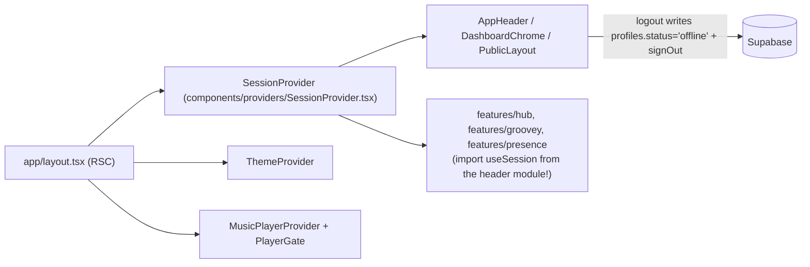

# GroovePH — Frontend / Backend Architecture

> How the code is actually split. No Server Components do data fetching next to the client except the two deliberate cases noted (`/` front door, admin layout, `/admin/*` gates, OAuth callback, a few server wrappers). The codebase is **client-first**: almost all data lives behind browser Supabase calls with RLS, and the "backend" is (a) route handlers under `app/api/`, (b) a handful of Server Actions, (c) the database itself.

## 1. Server Components (RSC) vs Client Components — counts

Measured on the working tree (line-1 directive check):

| Area | Total files | With `'use client'` | % client |
|---|---|---|---|
| `app/` | 127 | 48 | 37.8% |
| `components/` | 204 | 166 | 81.4% |
| `features/` | 274 | 175 | 63.9% |
| `lib/` | 67 | 10 | 14.9% |

No file anywhere contains `import 'server-only'`. Layering safety (never import `lib/supabase/server.ts` or `features/groovey/server/gemini.ts` from a client module) is **convention only** — code review, not enforcement.

### Server Components (default) — what they do

- **Root & special files**: `app/layout.tsx`, `app/not-found.tsx`, `app/error.tsx`*, `app/global-error.tsx`* (*client boundaries).
- **Public pages**: `(public)/page.tsx` (role redirect + `LandingPage`), `about`, `about-project`, `faq`, `support`, `performing-arts-philippines`, `community/*` (all discipline pages, `[discipline]`, `history`).
- **Auth pages**: none — all client.
- **Thin portal pages**: `…/groovey`, `…/messages`, `…/performing-arts-philippines`, `…/appointments` (legacy redirects), `…/profile/edit` (redirects), `coach/talent` (re-export).
- **Admin**: `app/admin/layout.tsx` (the gate), `verify-passcode/page.tsx`.
- **Server wrappers in features**: `features/*/components/*CommunityPageServer.tsx`, `HubRoute`, `PerformingArtsHistoryPage`, `DisciplinePageHeader`, `AttributionFooter`.
- **Examples with real work**: `app/(public)/page.tsx` (Supabase call + redirect), `app/admin/layout.tsx` (gate), `app/auth/callback/route.ts` (not a page — code exchange).

### Client Components — what they do

Everything interactive: forms, portals, admin console pages, feeds, profiles, the messenger Hub, Groovey AI, the music player, studio locator, theme system. They fetch **directly from Supabase using the browser client** (`lib/supabase/client.ts`) under RLS — no API hop for most reads. Writes that are privileged go through `/api/admin/*` routes or server actions.

Rule of thumb used by the codebase: **RSC renders the skeleton; the client component does the work.** Server data-fetching exists only where redirects or gates are needed before first paint.

---

## 2. Frontend responsibilities (the actual files)

| Concern | Implementation |
|---|---|
| Pages & routes | `app/**/page.tsx` — see `docs/PROJECT_STRUCTURE.md` §2 for the full split. |
| Layouts | Root `app/layout.tsx` (+every route group has its own `layout.tsx`): `(public)` minimal passthrough, `(auth)` dark shell, `(client)`/`(coach)` → `ClientLayout`/`CoachLayout` wrappers, `admin` server gate → `AdminLayout`. |
| Reusable UI | `components/ui/` (design system), `components/shared/`, `components/loading/` — the big buckets (see AUDIT for inconsistency). |
| Forms & validation | Hand-rolled per page: `RegistrationFormFields.tsx` (1,341 lines, shared client/coach), `ProfileFormSections.tsx` (849), `AddressSelector.tsx` (1,252) — **no React Hook Form**, validation inline (lengths, requireds) + bucket-side storage checks. |
| Custom hooks | `hooks/useProfile.ts` (loading/error/refresh), `useDebouncedValue`, `usePlayerVisible`; feature hooks: `useBookingsLive`, `useHubBadge`, `usePresence(Map)`, `useDirectoryFilters`, `useGlobalSearch`, `useTalentSelection`, `useAchievements`. |
| State management | React context: `SessionProvider` (session god-object), `ThemeProvider`, `LanguageProvider`, `MusicPlayerContext`, `ChatContext` (Groovey), `AdminContext`, `SmoothScrollProvider`, `SuccessNotificationProvider`. No Redux/Zustand/Jotai. TanStack Query is **not** used. |
| Side effects | Presence (`PresenceBridge`), click sound (`ClickSoundBridge`), platform theme sync (`PlatformThemeSync`), achievement refresh, notifications (`NotificationDropdown` with Realtime). |

## 3. Backend responsibilities (the actual files)

| Concern | Implementation |
|---|---|
| Route handlers (API) | `app/api/**/route.ts` — 30 handlers. See `docs/API_ENDPOINTS.md` for per-route methods/auth/tables. |
| Server Actions | `app/actions/achievements.ts` (badge engine hooks), `app/admin/verify-passcode/actions.ts` (passcode compare). Both `'use server'`. |
| Business logic | Pure/isomorphic modules: `features/appointments/services/{bookingStatus,bookingTime,…}.ts`, `features/booking/services/agreementStatus.ts`, `features/hub/services/*`, `lib/achievements/*`, `lib/masking.ts`, `lib/postgrest.ts`, `lib/rateLimit.ts`. Browser-side services: `features/appointments/services/bookingService.ts` (**'use client'**), `features/community/services/communityService.ts`, `features/home/services/homeService.ts`. |
| Authentication & authorization | See `docs/AUTHENTICATION_FLOW.md`. Browser: `lib/supabase/client` + RLS. Server: `requireAdmin()` / `getUser()` / `authorizeCronRequest()` / `INGEST_API_KEY` checks. |
| Database access | Browser (RLS as caller) for ~all app reads; server cookie client for RSC/gates; service-role only in: `/api/admin/users`, `/api/admin/audit`, `/api/tickets` (conditional fallback), `/api/cron/*`, `/api/{dance,singing,acting,theater}/ingest` + discipline `*Service.ts` (agents/ingest only). |
| External APIs | Gemini/Groq/OpenRouter (Groovey + coach assistant), Anthropic Claude (content agents), Google Places + Maps JS API + Nominatim (studios), YouTube IFrame/oEmbed (music), Resend (email), PSGC data for addresses. |

## 4. The session & chrome layer (most important boundary)

`SessionProvider` now lives in **`components/providers/`** (moved in Phase 3) and is consumed by app layers, components, and features alike — a proper providers home instead of a header component owning app-wide auth state. `header/` and `layout/DashboardChrome` only *consume* the context; sign-out itself is shared via `lib/auth/signOut.ts#signOutEverywhere`. See AUDIT (H-2) for the pre-Phase-3 state.

## 5. Communication patterns

1. **RSC → client props**: rare. Example: `userprofile/[id]` does not follow this pattern (all client). `/` passes nothing (children only).
2. **Client → Supabase (browser, RLS)**: the default for reads and member-scoped writes.
3. **Client → API route → Supabase/external**: for privileged or external-API work — admin lifecycle (`/api/admin/users`), tickets, emails, Groovey AI, oEmbed, studios, agents.
4. **Client → Server Action**: achievements only.
5. **Supabase Realtime → client**: bookings (`useBookingsLive`), notifications (`NotificationDropdown`), presence (`usePresence`), messages/Hub (via `useBookingsLive` + table subscriptions), system theme (`PlatformThemeSync`).
6. **Scheduled jobs (Vercel cron → HTTP)**: `/api/cron/*` → agent functions → Anthropic API → ingest route handler logic → Postgres (`dance_updates`, etc.). These are the **only** code paths that write the discipline content tables.
7. **DEAD paths (verified zero importers)**: `features/auth/*` (role-picker cards), `features/appointments/{BookingCard,BookingSummaryStrip,CoachAvailabilitySnapshot,RescheduleDialog,StatusFilterBar}`, `features/booking/{AgreementThread,ConversationAgreements,ContactOverview,AgreementTermsForm}`, `features/groovey/{GrooveyStudioLobby,GrooveyBottomNav,InteractivePracticeBar+audio.ts}`, `features/payments/*` (entire payment-request subtree; only `GCashQrField` is live), `features/music/{curatedTracks,config/genres}`, `components/shared/{ProfileHero,GoogleSignInButton,ImageCard,Sidebar,UserSearchResults,useScrollReveal}`, `components/landing/{Hero,HeroStats,FinalCta,StudiosPreview,SectionTransition,TextReveal,LandingScrollCoordinator,useSmoothScroll}`, `components/faq/{FaqTeaser,FaqTeaserSection}`, `components/dashboard/{StatCard,StatRow+MetricStatCard,CoachDashboardBackground,PhilippineBackdrop,PhilippineSun,BadgeMiniWidget,CoachAvatarRow,SupportCallout,UpcomingSessionsWidget}`, `components/layout/SiteHeader`, `components/ui/{Accordion,SelectCard,Stepper}`, `components/profile/{bento/*,ProfileMoreMenu}`, `constants/routes.ts`, `features/dance/components/MatchRecapsSection`, `features/appointments/services/appointmentService.ts` (legacy), `features/hub/components/HubSignoffs.tsx`, and **all 16 feature barrel files** (except groovey/music deep use).

Dead-code total: **≈70 files, ≈430 KB** (plus 14 effectively-unused feature barrels) — see AUDIT §H-1 for the severity-annotated list. Do not delete without review: some are referenced by scripts (e.g. `pov.ts` by `scripts/test-hub-logic.ts`).

## 6. Shared vs feature vs app — what belongs where (as enforced today)

| Layer | Today's contents | Rule the codebase actually follows |
|---|---|---|
| `app/` | routes + RSC pages + the two server gates | URL-addressable only; no reusable UI except admin `verify-passcode/PasscodeForm.tsx` (colocated) |
| `components/` | cross-feature UI | reused by ≥2 features or app-wide; contains many one-off/dead files today |
| `features/` | feature-local UI + services | owned by one feature; may be imported by `app/` pages but not by other features' internals (violated: dance↔performing-arts↔disciplines cluster; components→features/groovey; lib→features/groovey) |
| `lib/` | isomorphic core | no React components except `lib/i18n/LanguageProvider.tsx` (also mounted at root) |
| `hooks/` | app-wide hooks | only 3 files |
| `config/` | static registries | `dashboard-widgets.ts` is the de-facto widget catalog |
