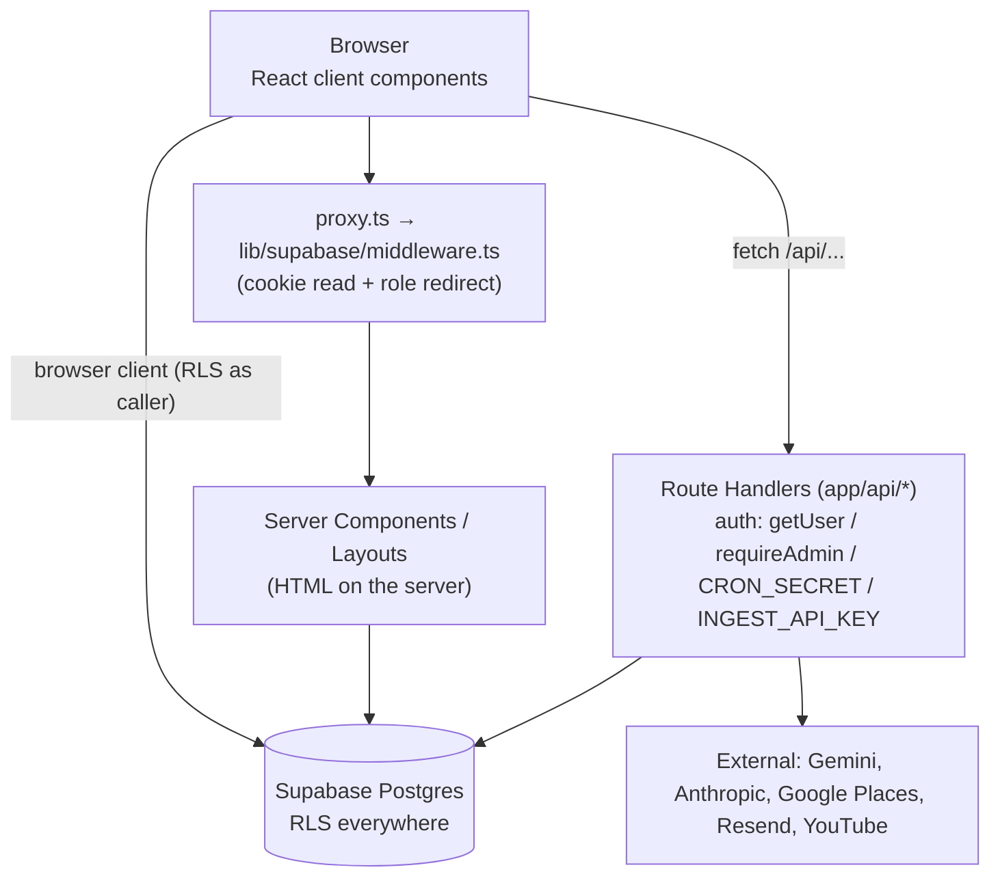

# GroovePH — System Overview

> GroovePH (`groove` on disk, `"Groove"` product name) is a production-oriented web platform for the performing-arts community of San Jose del Monte, Bulacan. It connects **performers** and **coaches** across dance, vocal arts, acting, and musical theatre with discovery, scheduling, digital agreements, studio geolocation, payments, discipline-specific community feeds, and an AI assistant ("Groovey").

This document explains, in plain language, what the system is and how the big pieces fit together. It reflects the **actual implementation** in this repository, not a target architecture. See `docs/PROJECT_STRUCTURE.md` for the folder-by-folder guide and `docs/ARCHITECTURE_AUDIT.md` for the full audit and refactoring roadmap.

Last updated: 2026-11-19.

---

## 1. What the product does

| Audience | Surface | Access |
|---|---|---|
| Guests | Public landing, discipline ("Performing Arts Philippines") pages, FAQ, terms, privacy, support, member directory, public profiles | Open |
| Clients (performers) | Client portal: `/client/*` — dashboard, talent/coach discovery, bookings, calendar, messages, profile, settings, Groovey AI | Authenticated |
| Coaches | Coach portal: `/coach/*` — dashboard, requests/bookings, calendar, messages, profile, settings, Groovey AI | Authenticated |
| Administrators | Admin console: `/admin/*` — users, verifications, bookings, inquiries, announcements, maintenance, theme, audit, transactions | Server-guarded (see below) |

Feature list (all implemented and reachable in production unless marked otherwise):

- Multi-step client and coach registration wizards (email/password) with government-ID upload, address selection (PH "PSGC" data), terms acceptance, and verification-document review.
- Google OAuth registration *and* sign-in (via Supabase Auth + a role carried through the OAuth round trip).
- Email/password login (username or email), "remember me", forgot/reset password.
- Role-based portals with a shared "Hub" messaging + bookings surface (`/messages` → client/coach/admin variants).
- Booking lifecycle: request → accept → agreement terms → in-app signing → in-progress → completed; reschedule requests; ICS export; post-session feedback and star ratings.
- Digital session agreements with canvas e-signature capture; stored in a private Storage bucket; rendered on a contract page (`/contracts/[id]`).
- Community showcase feed per discipline (dance, singing, acting, theatre) with media, reactions, comments, leaderboard, community rules.
- Discipline-specific public news/events hubs ("DanceBeat", "SingingBeat", "ActingBeat", "TheaterBeat") populated by scheduled AI agents (Anthropic Claude) + human-curated fallbacks, served from public API routes.
- Studio locator: search rehearsal studios near a point or nationwide (Google Places API New + admin-managed `studios` table + curated fallback), interactive Google Map.
- Groovey AI assistant (Google Gemini with Groq/OpenRouter fallback) — chat UI, streaming, repertoire/artist notes, marketing to members only.
- GCash payments between coach and client (QR upload + payment request/proof/review) — **backend exists, UI is not wired in** (see ARCHITECTURE_AUDIT §dead code).
- Achievements/badges, profile follows, in-app notifications, presence (online/away/busy/offline), global music player, theme system (dark/light + seasonal), PII masking for public surfaces.
- Admin console with server-side identity gate, optional 6-digit passcode second factor (`/admin/verify-passcode`), audit logging, admin-created accounts, and platform theme control.

---

## 2. Tech stack

| Layer | Choice |
|---|---|
| Framework | Next.js 16.3.3 (App Router, React 19.2.8, TypeScript strict) |
| Request boundary | `proxy.ts` (Next 16 renamed `middleware.ts` → `proxy.ts`) → `lib/supabase/middleware.ts` |
| Auth | Supabase Auth (email/password, Google OAuth, recovery links) via `@supabase/ssr` + `@supabase/supabase-js` |
| Database | Supabase Postgres (RLS on every table), 41 SQL migrations in `supabase/migrations/` (00–40) |
| Storage | Supabase Storage buckets: `verification-documents` (private), `contract-signatures` (private), `payment-qr-codes` (private), `media-posts`, `avatars` (public) |
| Realtime | Supabase Realtime (bookings, notifications, presence) |
| Styling | Tailwind CSS v4 (`@import "tailwindcss"` + `@theme` tokens in `app/globals.css`, self-hosted fonts) |
| AI | Google Gemini (`@google/genai`), fallback Groq → OpenRouter; Anthropic Claude for the content agents; OpenRouter/DeepSeek for the coach assistant |
| Maps | Google Maps JS API + Places API (New); OSM Nominatim as geocoding fallback |
| Email | Resend (welcome email; Supabase custom SMTP for auth mail) |
| Validation | zod (boundaries only) + hand-rolled checks; no React Hook Form |
| Hosting | Vercel (cron jobs defined in `vercel.json`) |

---

## 3. The five layers of the app (simple mental model)

Any table read/write from the **browser** goes through Postgres Row Level Security as the signed-in user. Privileged writes from the **server** either re-check identity (`requireAdmin`) or use a service-role client that bypasses RLS — never both by accident. See `docs/DATABASE_AND_SUPABASE.md`.

---

## 4. Security model at a glance

1. **Session** — Supabase issues a JWT stored in a cookie (`sb-<project-ref>-auth-token`). `proxy.ts` refreshes it on every non-API request.
2. **Routing authorization** — `lib/supabase/middleware.ts` classifies each request (`auth | admin | coach | client | shared | public`) and redirects based on the **`profiles.role` row** (never `user_metadata.role`, which the client controls).
3. **Admin** — the `/admin` tree requires `profiles.role === 'admin'` **and** the account email equal to the `ADMIN_EMAIL` pinned address (`lib/admin/access.ts#isAdminIdentity`). Enforced in four places that must stay in sync: middleware, `app/admin/layout.tsx`, `requireAdmin()` in API routes, and Postgres `public.is_admin()` used by admin RLS policies.
4. **Second factor** — optional 6-digit passcode at `/admin/verify-passcode` (constant-time compare, server-only). Nothing forces an admin through it; it is opt-in.
5. **RLS** — every table has row-level security; public read surfaces use explicit column allowlists (`lib/publicProfile.ts`) and PII masking (`lib/masking.ts`).
6. **Abuse control** — in-memory rate limiters (`lib/rateLimit.ts`, per-process), same-origin checks (`lib/sendEmailSecurity.ts`), PostgREST filter escaping (`lib/postgrest.ts`), cron fail-closed (`lib/cron/auth.ts`), upload allowlists (`lib/uploadValidation.ts`).
7. **No secrets in the client** — only `NEXT_PUBLIC_*` vars are exposed; the service-role key is server-only and placeholder-tolerant (`lib/supabase/server.ts`).

Known gaps and risks are listed in `docs/ARCHITECTURE_AUDIT.md` (severity-classified). Notable ones called out there: dead Google sign-in button on `/login`, unused orphaned modules (~30 files), and a landing-page "fallback" stat block that contradicts the repo's no-invented-numbers rule.

---

## 5. Request lifecycle example (member opens `/coach/home`)

1. Browser requests `/coach/home`. `proxy.ts` runs `updateSession()`.
2. No session cookie → redirect to `/login?redirectTo=/coach/home`.
3. Session cookie present → cookie is refreshed; server calls Supabase `auth.getUser()` + reads `profiles` row.
4. Role is `coach` → request proceeds; role is `client` → redirect to `/client/home`; role is `admin` but not pinned → `/client/home`; full admin pin → `/coach/home` is allowed (admins may view portals).
5. `app/(coach)/coach/layout.tsx` renders `<CoachLayout>` (sidebar + chrome). The page (`'use client'`) independently re-checks `profiles.role === 'coach'` and fetches widget data via `features/home/services/homeService.ts` (browser Supabase client, RLS).
6. Widgets render; Supabase Realtime subscriptions keep bookings/notifications live.

---

## 6. Repository vitals (2026-11-19)

- ~682 source files under `app/ components/ features/ hooks/ lib/ config/ constants/ src/ agent/` (TypeScript/CSS).
- ~1,506 KB `app/` (split across 129 files), ~1,522 KB `components/` (204), ~2,230 KB `features/` (274), ~424 KB `lib/` (67).
- `app/globals.css` alone is **678 KB / 15,134 lines** — the entire design system.
- Public assets in `public/` are ~170 MB (mostly photography).
- No `middleware.ts` — the request boundary is `proxy.ts`.
- Pre-existing uncommitted changes (not part of this audit): `app/api/groovey/chat*.ts`, `app/api/send-email/route.ts`, `lib/grooveyValidation.ts`, `lib/sendEmailSecurity.ts`, `scripts/test-groovey.ts`, `scripts/test-send-email.ts`.
